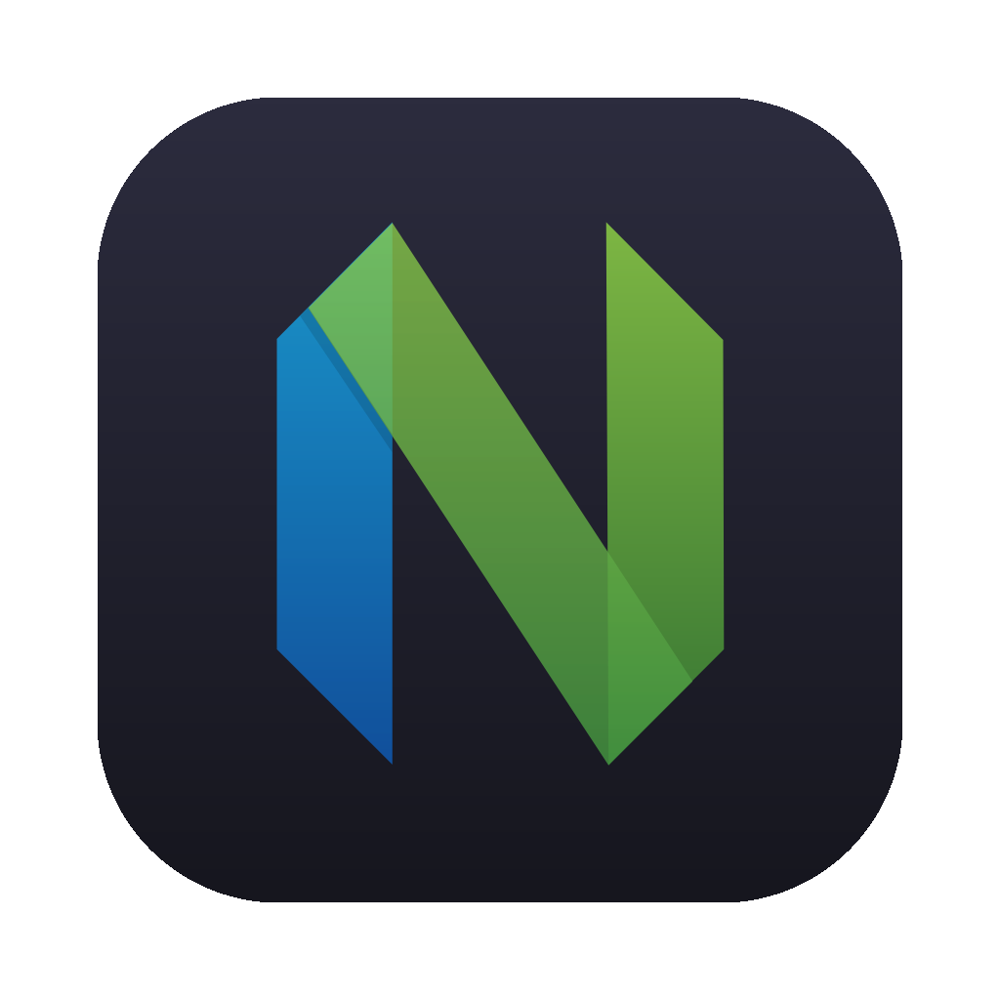

# ghostty-nvim-open

Point macOS file associations at Neovim running in the terminal, so Cmd+Click on a
file path in Ghostty (say `src/foo.ts` from pi output) opens `nvim` in a new tab of
the current window instead of launching VSCode.

## Why this exists

- `nvim` is a CLI tool. LaunchServices only accepts `.app` bundles, so there is no way
  to make it the default handler directly.
- Ghostty 1.4.1 hardcodes Cmd+Click on bare paths to the system `open`, ignoring
  `$EDITOR` (ghostty-org/ghostty#1972 is still an open feature request).
- The `link` config key added in 1.4.1 would be the real fix, but
  `ghostty +validate-config` still returns `link: error.NotImplemented`.

So the approach is a tiny AppleScript app acting as a LaunchServices middleman: it
receives files and asks Ghostty to open a new tab running nvim. `duti` then points the
common text UTIs at it.

## Requirements

- macOS (built and tested on macOS 26 / Apple Silicon)
- [Ghostty](https://ghostty.org) 1.4 or newer
- Neovim in `PATH`
- [`duti`](https://github.com/jrawit/duti): `brew install duti`

## Install

```fish
git clone https://github.com/Andy8647/ghostty-nvim-open
cd ghostty-nvim-open
bash install.sh
```

macOS will ask a few times whether all files of type `.<ext>` should open with
NvimHere. Click **Use**.

Two behaviours worth knowing:

- **The app is not rebuilt by default.** Only `bash install.sh --force` rebuilds it.
  Rebuilding deletes `~/Applications/NvimHere.app`, and LaunchServices drops every
  association pointing at it, so you have to approve all the dialogs again.
- **Associations are set at UTI level** (`public.source-code`, `public.plain-text`,
  `net.daringfireball.markdown`, and so on). One UTI covers many extensions, which
  keeps the dialog count around 8 instead of 30+.

Changing the nvim path, the AppleScript, or the set of claimed types: edit, then
rebuild once with `--force` and approve the dialogs again.

## Uninstall

```fish
bash uninstall.sh
```

Defaults to handing the associations back to VSCode:

```fish
bash uninstall.sh --to com.apple.TextEdit   # hand them to TextEdit instead
bash uninstall.sh --keep-app                # restore associations, keep the .app
```

## Layout

```
src/NvimHere.applescript   # the middleman; __NVIM__ becomes an absolute path at install
assets/nvim.icns           # app icon (official Neovim mark on a macOS squircle)
assets/make-icon.sh        # regenerate it: neovim-mark.svg -> nvim.icns
tools/set-browser.swift    # reset the default browser / http(s) handlers
install.sh                 # compile app + register with LaunchServices + set handlers
uninstall.sh               # restore handlers (VSCode by default)
```

## Icon



The icon lives in `assets/nvim.icns`: a 1024 canvas with an 824 rounded square of
radius 185, official Neovim mark centred on top. To change it:

```fish
cd assets
bash make-icon.sh          # regenerate nvim.icns
cd .. && bash install.sh   # copies it in place, no rebuild, associations survive
```

Finder caches icons aggressively; `killall Finder` refreshes it.

## Implementation notes

- Ghostty runs `command` through `/bin/bash -c` with the minimal GUI PATH, so nvim is
  referenced by absolute path.
- The AppleScript must say `new tab in w with configuration cfg`. Plain `new tab`
  fails with `-1708 Can't continue new tab`.
- The app sets `LSUIElement`, so it stays out of the Dock and Cmd+Tab.
- Icon updates only copy the file and re-sign, they never remove the bundle, so
  approved associations survive.
- `LSHandlerRank` is `Owner`. With `Default`, Obsidian holds on to
  `net.daringfireball.markdown` and the user preference is ignored.
- Errors are appended to `~/Library/Logs/NvimHere.log`.

## Never associate HTML

`public.html` is not just a file type. macOS treats the HTML handler as the system
default browser (`com.apple.default-app.web-browser`, plus the `http` and `https`
URL schemes). If this shim claims HTML, every web link gets handed to it and opens
nothing. `install.sh` refuses to run if `public.html` is ever added to the UTI list.

If the browser gets clobbered anyway:

```fish
swift tools/set-browser.swift com.google.chrome
```

The `.html` / `.htm` extensions are still claimed, which only affects double-clicking
an HTML file; it does not touch the browser setting.

## Known limits

- Ghostty blocks Cmd+Click on local targets it considers executable (`.sh`,
  `.command`). There is no config key to disable that, so clicking a script path
  shows "Ghostty Blocked This Link". Double-clicking the same file in Finder still
  works, since that path does not go through Ghostty.

## Replacement for an installed editor

This setup is meant to survive removing VS Code. Two things make that work:

- The app declares each extension itself, in a `CFBundleDocumentTypes` entry with no
  `LSItemContentTypes` and `LSHandlerRank = Owner`. Extensions nobody declares
  resolve to throwaway `dyn.*` types, and LaunchServices will not store a default
  handler for those. When both keys sit in one dict, the extension bindings are
  silently dropped.
- `duti` still has to overwrite explicit per-type preferences left by the previous
  editor (`public.bash-script`, `public.objective-c-source`, and friends). Those
  override declaration ranking no matter what the rank says.

After removing the old editor, rebuilding the LaunchServices database clears its
stale claims:

```fish
/System/Library/Frameworks/CoreServices.framework/Frameworks/LaunchServices.framework/Support/lsregister \
  -kill -r -domain local -domain system -domain user
bash install.sh
```
